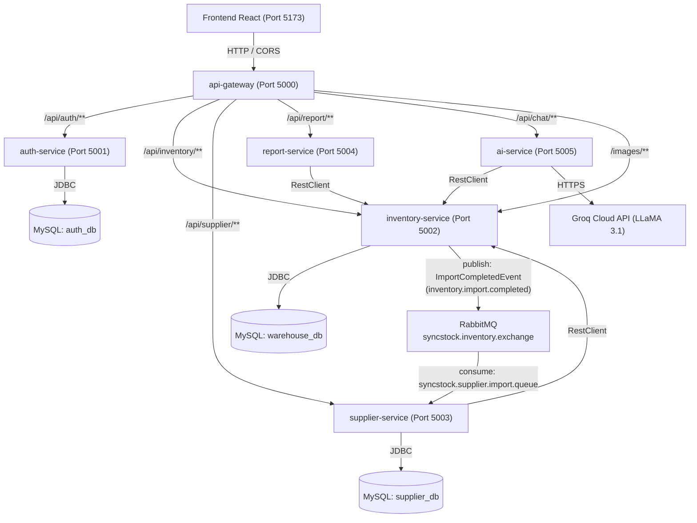

# SyncStock - Hệ Thống Quản Lý Kho Hàng Microservices

> Hệ thống quản lý kho hàng hiện đại xây dựng trên kiến trúc **Spring Cloud Microservices**, **Java 21 Virtual Threads**, **MySQL 8.0**, **RabbitMQ**, tích hợp **Groq AI LLM** và giao diện người dùng **React (TailwindCSS, Vite)**.

---

## 1. Tổng quan Kiến trúc

Hệ thống được thiết kế theo mô hình **Maven Multi-Module** gồm 1 Parent POM, 1 thư viện dùng chung (`common-lib`) và 6 Microservices độc lập:



### Danh mục Microservices & Cổng giao tiếp

> **Lưu ý bảo mật:** Trong môi trường tiêu chuẩn (`docker-compose.yml`), **chỉ duy nhất `api-gateway` (cổng 5000)** publish ra host để làm Single Entrypoint và bắt buộc mọi request phải đi qua Gateway (áp dụng CORS, định tuyến và kiểm soát bảo mật). Các cổng dịch vụ nội bộ (5001-5005) không publish ra ngoài. Cổng `mysql` (3307) và `rabbitmq` (5672, 15672) được cấu hình trong `docker-compose.dev.yml` dành riêng cho môi trường phát triển cục bộ (Local Dev).

| Service | Host Port | Container Port | Cơ sở dữ liệu & User | Chức năng chính |
| :--- | :---: | :---: | :--- | :--- |
| **`api-gateway`** | `5000` | `8080` | *Không* | Điểm vào duy nhất (Single Entrypoint), định tuyến API, xử lý CORS tập trung |
| **`auth-service`** | Nội bộ | `8080` | `auth_db` (`auth_user`) | Đăng ký, đăng nhập JWT, phân quyền (`Admin`, `ThuKho`, `KeToan`), quản lý User |
| **`inventory-service`** | Nội bộ | `8080` | `warehouse_db` (`inventory_user`) | Quản lý danh mục, sản phẩm, upload ảnh, nhập/xuất kho (Optimistic Locking `@Version`) |
| **`supplier-service`** | Nội bộ | `8080` | `supplier_db` (`supplier_user`) | Quản lý nhà cung cấp, tính toán điểm uy tín (Analytics Reliability Score) |
| **`report-service`** | Nội bộ | `8080` | *Stateless* | Tổng hợp tồn kho, doanh thu xuất/nhập kho, xuất file Excel (`.xlsx`) & CSV (UTF-8 BOM) |
| **`ai-service`** | Nội bộ | `8080` | *Stateless* | Trợ lý ảo AI phân tích kho hàng thời gian thực qua Groq LLM (`llama-3.1-8b-instant`) |
| **`mysql`** | Nội bộ / `3307` (Dev) | `3306` | Multi-DB | MySQL 8.0 khởi tạo 3 DB riêng biệt (`auth_db`, `warehouse_db`, `supplier_db`) với 3 user độc lập (Least Privilege) |
| **`rabbitmq`** | Nội bộ / `5672`, `15672` (Dev) | `5672`, `15672` | *Message Broker* | RabbitMQ 3 Management sẵn sàng cho xử lý bất đồng bộ |
| **`frontend`** | `5173` | - | - | Ứng dụng React + TailwindCSS + Vite |

---

## 2. Yêu cầu Môi trường

- **Java Development Kit (JDK):** Phiên bản 21 trở lên (Khuyến nghị: [Eclipse Temurin 21](https://adoptium.net/temurin/releases/?version=21)).
- **Node.js:** Phiên bản 18 trở lên & `npm`.
- **Docker & Docker Compose:** Docker Desktop hoặc Docker Engine (hỗ trợ Compose v2).
- **Maven:** Đã tích hợp sẵn Maven Wrapper (`mvnw` và `mvnw.cmd` phiên bản 3.9.16) trong dự án.

---

## 3. Cách 1: Khởi chạy bằng Docker Compose (Khuyến nghị)

Docker Compose là cách nhanh nhất và tiện lợi nhất để khởi chạy trọn vẹn toàn bộ 6 microservices cùng hạ tầng MySQL 8.0 và RabbitMQ.

### Bước 1: Chuẩn bị file môi trường `.env`
Sao chép file mẫu `.env.example` thành `.env` tại thư mục gốc của dự án:
```bash
# Trên Linux/macOS
cp .env.example .env

# Trên Windows PowerShell
Copy-Item .env.example .env
```
Mở file `.env` và điền cấu hình (nếu có API Key từ [Groq Console](https://console.groq.com/keys)):
```env
DB_PASSWORD=root
Groq__ApiKey=gsk_your_groq_api_key_here
Groq__Model=llama-3.1-8b-instant
Groq__BaseUrl=https://api.groq.com/openai/v1
```
*(Nếu chưa có Groq API Key, `ai-service` vẫn hoạt động với cơ chế Rule-based Engine cục bộ mà không gặp lỗi).*

### Bước 2: Build và khởi động các containers
Chạy lệnh Docker Compose từ thư mục gốc dự án:
```bash
docker compose up --build -d
```
Docker Compose sẽ:
1. Khởi chạy `mysql:8.0` và tự động thực thi `scripts/init-mysql.sql` để tạo 3 database: `auth_db`, `warehouse_db`, `supplier_db`.
2. Khởi chạy `rabbitmq:3-management`.
3. Biên dịch Multi-stage build bằng Maven và đóng gói 6 microservices vào các container siêu nhẹ sử dụng `eclipse-temurin:21-jre-alpine`.
4. Đợi MySQL đạt trạng thái `healthy` trước khi khởi chạy các microservices nghiệp vụ.

### Bước 3: Kiểm tra trạng thái hệ thống
Kiểm tra danh sách các container đang chạy:
```bash
docker compose ps
```
Xem log của toàn bộ hệ thống hoặc từng service:
```bash
# Xem log toàn bộ
docker compose logs -f

# Xem log riêng một service (ví dụ: api-gateway hoặc inventory-service)
docker compose logs -f api-gateway
docker compose logs -f inventory-service
```

### Bước 4: Khởi chạy Frontend React
Mở một cửa sổ dòng lệnh mới và khởi chạy ứng dụng Frontend:
```bash
cd frontend
npm install
npm run dev
```
Mở trình duyệt web và truy cập: **`http://localhost:5173`**

### Dừng hệ thống Docker:
```bash
# Dừng tất cả container
docker compose down

# Dừng và xóa toàn bộ dữ liệu database để reset trạng thái ban đầu
docker compose down -v
```

---

## 4. Cách 2: Khởi chạy Local (Dành cho Lập trình viên)

Dành cho quá trình phát triển (development) khi bạn muốn chỉnh sửa và debug code trực tiếp trên IDE.

### Bước 1: Khởi động MySQL 8.0 & RabbitMQ
Bạn có thể tận dụng Docker Compose kết hợp file override dev để mở cổng hạ tầng database & message broker ra máy host:
```bash
docker compose -f docker-compose.yml -f docker-compose.dev.yml up -d mysql rabbitmq
```
> **⚠️ Lưu ý cổng MySQL & RabbitMQ:** File `docker-compose.dev.yml` ánh xạ cổng MySQL sang **`3307:3306`** (tránh xung đột với MySQL cục bộ trên máy host) và RabbitMQ sang **`5672`**, **`15672`**. Khi chạy lệnh trên, từ máy host bạn kết nối MySQL qua cổng **`3307`** (ví dụ: `jdbc:mysql://localhost:3307/auth_db?...`).
>
> *(Nếu sử dụng MySQL cục bộ đã cài trực tiếp trên máy tại cổng `3306`, hãy chạy script `scripts/init-mysql.sql` để tạo databases và các users `auth_user`, `inventory_user`, `supplier_user` tương ứng).*

### Bước 2: Biên dịch toàn bộ các module Maven
Từ thư mục gốc dự án, biên dịch và nạp thư viện `common-lib` vào local repository:
```bash
# Trên Linux / macOS
./mvnw clean install -DskipTests

# Trên Windows PowerShell / CMD
.\mvnw.cmd clean install -DskipTests
```

### Bước 3: Khởi chạy từng Microservice
Khởi chạy lần lượt các microservice theo thứ tự khuyến nghị (mỗi service mở trên một terminal hoặc chạy trực tiếp bằng nút Run trong IDE IntelliJ / VS Code):

1. **Khởi chạy `auth-service` (Port 5001):**
   ```bash
   .\mvnw.cmd spring-boot:run -pl auth-service
   ```
2. **Khởi chạy `inventory-service` (Port 5002):**
   ```bash
   .\mvnw.cmd spring-boot:run -pl inventory-service
   ```
   *(Khi khởi chạy lần đầu, `DataSeeder` sẽ tự động tạo 3 danh mục và 20 sản phẩm mẫu).*
3. **Khởi chạy `supplier-service` (Port 5003):**
   ```bash
   .\mvnw.cmd spring-boot:run -pl supplier-service
   ```
   *(Tự động seed 2 nhà cung cấp mẫu).*
4. **Khởi chạy `report-service` (Port 5004):**
   ```bash
   .\mvnw.cmd spring-boot:run -pl report-service
   ```
5. **Khởi chạy `ai-service` (Port 5005):**
   ```bash
   .\mvnw.cmd spring-boot:run -pl ai-service
   ```
6. **Khởi chạy `api-gateway` (Port 5000):**
   ```bash
   .\mvnw.cmd spring-boot:run -pl api-gateway
   ```

### Bước 4: Khởi chạy Frontend
```bash
cd frontend
npm install
npm run dev
```
Truy cập: **`http://localhost:5173`**

---

## 5. Hướng dẫn Đăng nhập & Phân quyền Hệ thống

Hệ thống hỗ trợ cơ chế bootstrap quyền quản trị tự động:

1. **Đăng ký tài khoản Quản trị viên (Admin):**
   - Truy cập trang Đăng ký: `http://localhost:5173/register`
   - Đăng ký tài khoản đầu tiên (ví dụ: `admin` / `Admin@123`).
   - Hệ thống tự động gán role **`Admin`** cho tài khoản đầu tiên này.
2. **Tạo tài khoản Nhân viên (Thủ kho / Kế toán):**
   - Đăng nhập bằng tài khoản `Admin`.
   - Vào menu **Quản lý người dùng** (`/users`): Tạo mới người dùng với quyền `ThuKho` (Thủ kho) hoặc `KeToan` (Kế toán), hoặc khóa/mở khóa trạng thái tài khoản.
3. **Ma trận Phân quyền (Role Matrix):**

| Tính năng | Admin | ThuKho (Thủ kho) | KeToan (Kế toán) |
| :--- | :---: | :---: | :---: |
| **Quản lý người dùng (`/users`)** | ✅ Toàn quyền | ❌ | ❌ |
| **Xem danh sách sản phẩm & tồn kho** | ✅ | ✅ | ✅ |
| **Thêm, sửa, xóa sản phẩm & Upload ảnh** | ✅ | ✅ | ❌ |
| **Nhập kho hàng (`/import`)** | ✅ | ✅ | ❌ |
| **Xuất kho hàng (`/export`)** | ✅ | ✅ | ❌ |
| **Quản lý Nhà cung cấp (`/suppliers`)** | ✅ | ✅ | ❌ |
| **Xem Phân tích đối tác (Analytics)** | ✅ | ✅ | ✅ |
| **Báo cáo kinh doanh & Xuất Excel / CSV** | ✅ | ❌ | ✅ |
| **Trợ lý ảo AI Groq Chatbot (`/chat`)** | ✅ | ✅ | ✅ |

---

## 6. Kiểm tra Trạng thái Sức khỏe (Actuator Health Checks)

Trong kiến trúc bảo mật của SyncStock, **chỉ có API Gateway (Port 5000) được publish ra ngoài host**. Các microservices nội bộ (Auth, Inventory, Supplier, Report, AI) không expose cổng trực tiếp ra host để đảm bảo nguyên tắc Single Entrypoint và phòng chống tấn công bypass gateway.

Do đó, kiểm tra sức khỏe hệ thống được thực hiện qua **API Gateway** hoặc thông qua **`docker exec`**:

### Cách 1: Kiểm tra qua API Gateway (từ máy host hoặc trình duyệt)
- **API Gateway Health:**
  ```bash
  curl http://localhost:5000/actuator/health
  ```
  Hoặc truy cập trực tiếp trên trình duyệt: [http://localhost:5000/actuator/health](http://localhost:5000/actuator/health) (kết quả trả về: `{"status":"UP"}`).

### Cách 2: Kiểm tra các Microservices nội bộ qua `docker exec` (hoặc `docker compose exec`)
Do các service nội bộ chỉ lắng nghe trong mạng Docker (`syncstock-network`) tại cổng `8080`, sử dụng lệnh `wget` qua container để kiểm tra:

```bash
# Kiểm tra auth-service
docker compose exec auth-service wget -qO- http://localhost:8080/actuator/health

# Kiểm tra inventory-service
docker compose exec inventory-service wget -qO- http://localhost:8080/actuator/health

# Kiểm tra supplier-service
docker compose exec supplier-service wget -qO- http://localhost:8080/actuator/health

# Kiểm tra report-service
docker compose exec report-service wget -qO- http://localhost:8080/actuator/health

# Kiểm tra ai-service
docker compose exec ai-service wget -qO- http://localhost:8080/actuator/health
```

*(Ghi chú: Nếu sử dụng `docker exec`, có thể chạy: `docker exec -it <container_name> wget -qO- http://localhost:8080/actuator/health`).*

### Cách 3: Khi khởi chạy với `docker-compose.dev.yml` (Local Dev)
- **RabbitMQ Management UI:** [http://localhost:15672](http://localhost:15672) *(Tài khoản: `RABBITMQ_USER` / `RABBITMQ_PASS`)*
- **MySQL 8.0:** Host Port `3307`

---

## 7. Cấu trúc Thư mục Dự án

```
QuanLyKho-Spring/
├── api-gateway/            # Cổng Gateway MVC định tuyến, lọc CORS (Port 5000)
│   ├── Dockerfile
│   └── src/
├── auth-service/           # Microservice xác thực & người dùng (DB: auth_db, User: auth_user)
│   ├── Dockerfile
│   └── src/
├── inventory-service/      # Microservice kho hàng, nhập/xuất (DB: warehouse_db, User: inventory_user)
│   ├── Dockerfile
│   └── src/
├── supplier-service/       # Microservice quản lý nhà cung cấp (DB: supplier_db, User: supplier_user)
│   ├── Dockerfile
│   └── src/
├── report-service/         # Microservice báo cáo doanh thu & xuất Excel/CSV
│   ├── Dockerfile
│   └── src/
├── ai-service/             # Microservice AI trợ lý kho tích hợp Groq LLM
│   ├── Dockerfile
│   └── src/
├── common-lib/             # Thư viện dùng chung (JWT, Exceptions, DTOs)
│   └── src/
├── frontend/               # Ứng dụng React + TailwindCSS + Vite
├── scripts/
│   └── init-mysql.sql      # Script tạo 3 CSDL & 3 users riêng biệt (Least Privilege)
├── docker-compose.yml      # Cấu hình chuẩn triển khai toàn bộ hệ sinh thái (chỉ mở port 5000)
├── docker-compose.dev.yml  # Override mở port MySQL (3307) & RabbitMQ (5672/15672) cho Local Dev
├── .env.example            # Mẫu biến môi trường
├── pom.xml                 # Maven Parent POM quản lý dependencies
└── README.md               # Tài liệu hướng dẫn sử dụng
```
